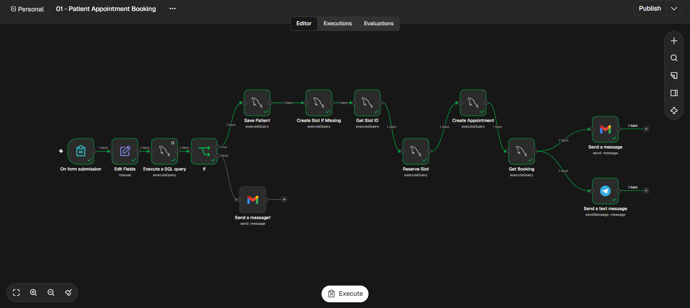

# SmartClinic — Patient Appointment Automation

A clinic appointment booking workflow built with **n8n, MySQL, Gmail, Telegram, and Docker**. SmartClinic accepts appointment requests, checks slot availability, stores bookings, and sends confirmation or unavailable-slot notifications.

## Workflow overview



## Project structure

```text
SmartClinic/
├── README.md
├── workflows/
│   └── smartclinic_appointment_booking.json
└── screenshots/
    └── workflow_overview.png
```

The workflow expects a compatible MySQL schema. A schema file is not included in this repository.

## Features

- Collects a patient's name, email address, doctor, date, and time.
- Checks whether the requested slot is already booked.
- Creates a slot record when needed, reserves the slot, and saves the appointment.
- Sends confirmation or unavailable-slot email through Gmail.
- Can send booking alerts through Telegram after an admin chat ID and Telegram credentials are configured.
- Uses n8n credentials for service connections; credentials and tokens are not stored in this repository.

The workflow does **not** collect or store phone numbers.

## How the workflow runs

1. The patient submits the n8n appointment form.
2. The workflow checks availability for the selected doctor, date, and time.
3. If the slot is unavailable, Gmail sends an unavailable-slot message.
4. If the slot is available, the workflow saves the patient record, creates or finds the slot, reserves it, and creates a booking reference.
5. Gmail sends the confirmation. Telegram sends an admin alert when configured.


## Requirements

- Docker Desktop, if running n8n and MySQL in Docker
- An n8n instance
- MySQL
- A Gmail account connected to n8n
- A Telegram bot and admin chat ID, if Telegram alerts are wanted

## Setup

### 1. Start your existing containers

In PowerShell, start the containers if they already exist:

```powershell
docker start n8n
docker start smartclinic-mysql
docker ps
```

If your containers use different names, substitute those names. The n8n container must be able to reach MySQL over the Docker network.

### 2. Prepare MySQL

Create a database and the tables expected by the workflow before importing it. Configure the MySQL connection in n8n using the correct host, port, database, username, and password for your environment. Do not put database passwords in the workflow file or this repository.

### 3. Import the workflow

1. Open n8n, commonly at `http://localhost:5678` for a local setup.
2. Choose **Import from File** and select `workflows/smartclinic_appointment_booking.json`.
3. Create or select the MySQL and Gmail credentials in n8n.
4. Review the doctor options and ensure their IDs match the doctor IDs used by your appointment-slot data.
5. Configure the form and activate the workflow when it is ready.


## Privacy and security

- Use fake test records while developing or demonstrating the workflow.
- Never commit patient data, passwords, API tokens, OAuth client secrets, or private chat IDs.
- Keep Gmail, Telegram, and MySQL credentials in n8n's credential store.
- Restrict access to the n8n form, database, and notification destinations appropriately before using real patient information.
- The workflow sends patient name and email in its notifications; treat execution data and message history as sensitive.

## Troubleshooting

- **MySQL connection errors:** Confirm both containers are running and that the MySQL host configured in n8n is reachable from the n8n container.
- **Missing-table or column errors:** Create a schema compatible with the SQL queries in the workflow.
- **Email failures:** Check the Gmail credential and the n8n execution details.
- **Telegram failures:** Check the Telegram credential and ensure `YOUR_ADMIN_CHAT_ID` has been replaced with the correct chat ID.
- **Doctor or slot mismatch:** Confirm the doctor IDs in the form match the IDs used in the appointment-slot records.

## Project goals

- Reduce manual appointment administration.
- Prevent duplicate bookings for the same slot.
- Send timely appointment updates.
- Provide a foundation for future cancellation, rescheduling, reminders, and reporting features.

